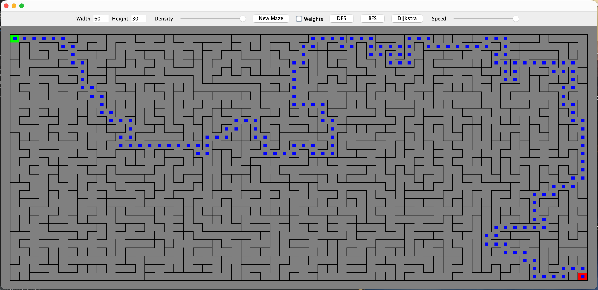

# Algorithmic Maze Solver

A Java application that represents mazes as weighted graphs and visualizes classic graph-search algorithms through a Swing interface.

**Author:** Pranav Khatri

## Demo

Demo: https://youtu.be/1AljVkasrG0?si=bHxNqy6XBYmLVYUX

## Highlights

- Generic directed weighted-graph data structure
- Breadth-first search (BFS) visualization
- Depth-first search (DFS) visualization
- Dijkstra's shortest-path algorithm for weighted mazes
- Conversion of generated mazes into graphs of maze junctures
- Reproducible maze generation using random seeds
- Adjustable maze dimensions, density, and visualization speed
- Observer callbacks for algorithm progress and GUI updates

## Academic context

Developed at the University of Maryland for **CMSC132: Object-Oriented Programming II** during the **Summer 2024** session, with **Professor Fawzi Emad**.

## Source code

The complete implementation is maintained in a separate private repository and can be shared with hiring recruiters privately upon request.

## Course policy

The source code remains private in accordance with the course policy. Please do not redistribute or reuse the implementation for coursework.
